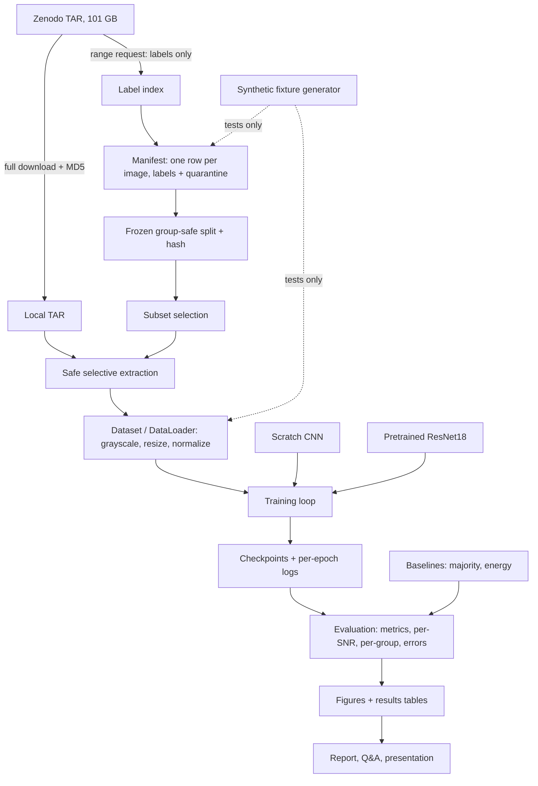

# Project Plan — Drone RF Spectrogram Classification

**Working title:** Drone Radio-Frequency Signal Classification from Spectrograms Using Convolutional Neural Networks
**Course:** Intro to AI main project (computer vision / CNN option, team of 3–4)
**Last updated:** 2026-11-12

This is the single document every team member should read first. It covers what we are building, the
dataset, the software architecture, the testing strategy, the experiments, and who can work on what.
Companion documents:

| Document | Purpose |
|---|---|
| [DOCUMENTATION_GUIDE.md](DOCUMENTATION_GUIDE.md) | How we write technical docs, conceptual Q&A, and presentation notes |
| [qa/CONCEPTS_QA.md](qa/CONCEPTS_QA.md) | Plain-language questions and answers (study guide / defense prep) |
| [presentation/PRESENTATION_NOTES.md](presentation/PRESENTATION_NOTES.md) | Slide-by-slide source material for the presentation |
| [DATASET_AUDIT.md](DATASET_AUDIT.md) | Measured counts and label-quality findings |
| [SPLIT_PROTOCOL.md](SPLIT_PROTOCOL.md) | The frozen train/validation/test split and leak checks |
| [DOWNLOAD_AND_STORAGE.md](DOWNLOAD_AND_STORAGE.md) | How to get the data and what has been downloaded |
| [RESULTS.md](RESULTS.md) | Measured results so far (validation only) |
| [CONFOUNDS_AND_LIMITATIONS.md](CONFOUNDS_AND_LIMITATIONS.md) | What the results can and cannot show |
| [technical/](technical/) | One page per pipeline stage |

### How to read the evidence labels

Every factual statement about the dataset or our results carries one of these labels. Do not remove
them, and do not upgrade a label without doing the check.

| Label | Meaning |
|---|---|
| **VERIFIED** | We checked it ourselves; the doc says how and when |
| **CLAIMED** | Stated by the dataset authors; we have not checked it yet |
| **ESTIMATE** | Our own rough calculation from partial evidence; will be replaced by a measured value |
| **UNKNOWN** | Nobody on the team knows yet; must be measured from real data |
| **PENDING** | Waiting on a person (professor, teammate) |
| **SYNTHETIC** | Produced from fake generated data; proves the code runs, says nothing about real performance |

---

## 1. The project in one page

**Research question.** How accurately can a CNN trained from scratch distinguish known drone-controller
RF emissions from Wi-Fi/Bluetooth background in this spectrogram dataset, and how does an
ImageNet-pretrained ResNet18 compare, especially as the signal-to-noise ratio (SNR) drops?

**Machine-learning task.** Binary image classification.

| | Class | Definition |
|---|---|---|
| 1 | `drone_rf` | Spectrogram from a drone-system recording (`target0`–`target5`) whose annotation file has at least one valid box |
| 0 | `background_rf` | Spectrogram from a `labnoise` (Wi-Fi/Bluetooth) recording whose annotation file is empty |

- **Input:** one 640×640 grayscale spectrogram PNG, resized to 224×224 (other sizes are an ablation).
- **Output:** probability that the image contains drone RF.
- **Two required models:** (A) a CNN we design and train from random initialization; (B) a ResNet18
  pretrained on ImageNet and fine-tuned.

**What this project is not.** It is not radar. It is not detecting a physical drone in the sky, not
direction finding, not geolocation, and not object detection (we do not train YOLO). We measure
performance on *these recordings* only and make no claim about real-world deployment.

**Optional extensions, only after the binary task works:** six-way transmitter classification
(DJI, FutabaT14, FutabaT7, Graupner, Turnigy, Taranis); cropped-box vs. whole-image comparison; a
seven-class variant. These never replace the binary deliverable.

---

## 2. Current status (2026-11-12)

| Item | Status |
|---|---|
| GitHub repository | Public: https://github.com/alexfreund381/drone-rf-spectrogram-classifier |
| Professor approval of dataset and task | **Approved** (reported by the team on 2026-11-10) |
| Code: data pipeline, splits, both models, training, evaluation, baselines, confound checks, CLI | **Implemented** |
| Tests | 121 passing on synthetic fixtures (`pytest -q`); 1 integration test passed (real ImageNet ResNet18 weights downloaded and verified) |
| Label audit of the whole dataset | **VERIFIED**: 333,164 label files, 12,814 source samples, 12,504 usable ([DATASET_AUDIT.md](DATASET_AUDIT.md)) |
| Train/val/test split | **Frozen**, hash `ddfcbce03785a3af` ([SPLIT_PROTOCOL.md](SPLIT_PROTOCOL.md)) |
| Images on disk | Pilot sample: 10,407 images (3.2 GB of the 101 GB archive), 7,107 distinct source samples |
| Full 101 GB archive | Not downloaded |
| Experiment configs (A1, A2, B1, C1, C1b) | Written in `configs/` |
| Baselines (A0), scratch CNN (A1), pretrained ResNet18 (B1) | **Run on real images; validation results in [RESULTS.md](RESULTS.md)** |
| All-SNR training (C1, C1b), augmentation (A2) | **Not finished** |
| Test split | **Untouched** |
| Main findings so far | At SNR ≥ 0 dB a 39-number brightness baseline separates the classes perfectly; neither network beats it there, and both ignore the drone bursts at high SNR. Trained on clean images only, the pretrained ResNet18 is no better on noisy images than the scratch CNN. See RESULTS.md |
| CI workflow | Written (`.github/workflows/ci.yml`); its result on GitHub has not been checked |
| Deadline, grading rubric, presentation length, workstream owners | UNKNOWN — the team must add them |

---

## 3. Assignment requirements and where each will be satisfied

The exact grading rubric and the deadline have not been given to us. Do not invent them.

| # | Requirement (as known) | How we satisfy it | Evidence location | Status |
|---|---|---|---|---|
| 1 | Professor approves dataset/task | Approved; reported by the team on 2026-11-10 | — | Done |
| 2 | Interesting real-world dataset; ≥100 observations per class; ~5,000 images preferred | 8,562 drone and 3,942 background source samples (not counting noise copies) | `docs/DATASET_AUDIT.md` §2 | Done (VERIFIED) |
| 3 | Dataset described: URL, download link, size, shape, class counts, targets, what is predicted | Audit document | `docs/DATASET_AUDIT.md` | Done |
| 4 | First network built from scratch, no pretrained weights | `ScratchCNN` in `models.py`, run A1 | `docs/RESULTS.md` | Trained (validation results only) |
| 5 | Second model from a pretrained network; choose fine-tuning epochs | ResNet18 (ImageNet), two-stage fine-tune, early stopping on validation | `docs/RESULTS.md` ("Choosing the fine-tuning length") | Trained (validation results only) |
| 6 | Train / validation / test split; tune hyperparameters and augmentation; record experiments; analyze errors | Group-safe frozen split; experiment matrix (§7); error gallery | `docs/SPLIT_PROTOCOL.md`, `docs/RESULTS.md` | Split done; A0 and A1 recorded; **no tuning, augmentation or error gallery yet** |
| 7 | Runnable prototype and team presentation; everyone can explain decisions | CLI + docs + Q&A + presentation notes | repo, `docs/qa/`, `docs/presentation/` | Prototype runs; presentation outline only |

AI assistance is permitted (Level 5), but every team member must be able to explain the code and the
choices. That is why the Q&A and presentation documents exist.

---

## 4. Dataset

### 4.1 Source

| | |
|---|---|
| Title | *Drone RF Emissions in Spectrograms* |
| Zenodo record | https://zenodo.org/records/21428081 |
| DOI | https://doi.org/10.5281/zenodo.21428081 |
| Archive (direct download) | https://zenodo.org/records/21428081/files/LocalisingDroneRFEmissionsInSpectrograms.tar?download=1 |
| Dataset README | https://zenodo.org/records/21428081/files/README.md?download=1 |
| Authors' code | https://github.com/juliankraft/LocalisingDroneRFEmissionsInSpectrograms |
| Paper | Glüge, Kraft, Schüpbach, Nyfeler — *Localising Drone RF Emissions in Spectrograms: Automatic Annotation and Noise-Robust Object Detection*, NCTA 2026. No paper DOI confirmed; cite the dataset DOI. |
| Dataset creators (Zenodo) | Julian Kraft; Stefan Glüge (Zurich University of Applied Sciences); Christof Schüpbach; Matthias Nyfeler |
| License | CC BY 4.0 (attribution required) |
| Published | 2026-07-18; single version on Zenodo |

### 4.2 Facts we verified on 2026-11-10

Method: Zenodo REST API (`/api/records/21428081`), the downloaded README, and two HTTP range
requests that fetched only the **first 2 MB** and **last 1 MB** of the archive. Nothing else was
downloaded.

| Fact | Value | How verified |
|---|---|---|
| Archive size | 101,077,473,280 bytes (101.1 GB / 94.1 GiB) | Zenodo API, and `Content-Range` header |
| Archive MD5 (published) | `0e9e7f813de8d3816e6293bf37c3a8c6` | Zenodo API. We have **not** hashed the file ourselves. |
| Other files in record | `README.md` (4,266 B), `LICENSE` (18,656 B) | Zenodo API |
| Server supports byte ranges | Yes (`206 Partial Content`, `accept-ranges: bytes`) | Range request |
| Archive format | Uncompressed POSIX `ustar` TAR | Parsed headers in first 2 MB |
| Top-level folder | `LocalisingDroneRFEmissionsInSpectrograms/` with `images/` then `labels/` | Head and tail headers |
| Image filename pattern | `IQdata_sample<N>_<tag>_snr<S>db.png`, e.g. `IQdata_sample3693_target1_snr-2db.png` | 7 image headers |
| Label filename pattern | Same stem, `.txt`, under `labels/` | 1,241 label headers in the tail |
| Member order | Shuffled (not sorted by sample, class, or SNR) | Head and tail |
| Images come first, labels are at the end | The last 1 MiB contains only label files | Tail probe |
| PNG size on disk | 291–316 KB each in the 7 we saw | Head headers |
| Label row format | `class_id x_center y_center width height`, 6 decimals, e.g. `1 0.233398 0.098633 0.019531 0.142578` | Tail contents |
| `labnoise` files also have SNR variants | e.g. `IQdata_sample10880_labnoise_snr-30db.png` | Head header |
| **Some drone-tagged label files are empty** | In the tail sample: 35 of 831 `target*` labels were empty (23 `target0`, 8 `target3`, 3 `target1`, 1 `target5`). All 410 `labnoise` labels were empty. | Tail contents |
| Authors' task | YOLOv8s object detection, 5-fold CV | Authors' repo |

The empty drone-tagged labels matter: a filename tag alone is not a reliable label. This is exactly
why §4.6 quarantines `target*` images with zero boxes instead of calling them positive or negative.

### 4.3 Claims from the authors we have not checked

| Claim (CLAIMED) | Source |
|---|---|
| Images are 640×640, 8-bit grayscale PNG log-power spectrograms | README |
| Drone systems recorded in an anechoic chamber; background recorded in a public university building | README, Zenodo |
| Boxes were generated automatically by energy-based segmentation, with no manual labelling | README |
| 26 AWGN versions from −30 dB to +20 dB in 2 dB steps; noise was added to the IQ signal before the spectrogram was computed | README |
| Every image has a label file with the same stem | README |
| Tag → system: `target0` DJI, `target1` FutabaT14, `target2` FutabaT7, `target3` Graupner, `target4` Turnigy, `target5` Taranis, `labnoise` Wi-Fi/Bluetooth | README |
| YOLOv8s reaches mAP50 ≈ 0.95 on clean data | README. Not comparable to our accuracy/F1. |

### 4.4 Measured counts and remaining unknowns

The estimates originally in this section have been replaced by measurements. Full tables are in
[DATASET_AUDIT.md](DATASET_AUDIT.md).

| Item | Value | Label |
|---|---|---|
| Label files | 333,164 | VERIFIED |
| Source samples | 12,814, each at exactly 26 SNR levels | VERIFIED |
| Usable source samples | 8,562 `drone_rf`, 3,942 `background_rf` | VERIFIED |
| Quarantined | 310 drone-tagged samples with no boxes (215 of them DJI) | VERIFIED |
| Sample IDs unique across tags | Yes; contiguous 0–12,813, one block per tag | VERIFIED |
| Labels identical across a sample's SNR versions | Yes, for every sample | VERIFIED |
| Separate noise-free ("pristine") files | None in the label set | VERIFIED |
| Image format | 640×640, 8-bit grayscale PNG | VERIFIED on the 10,407-image pilot sample; CLAIMED for the rest |
| Neighbouring sample IDs independent? | Evidence says no (box counts of neighbours are correlated) | VERIFIED correlation; interpretation is ours |
| Number of independent recording sessions | No session identifier exists | UNKNOWN |
| Image axis orientation, sample rate, bandwidth | Not in the README; do not label plot axes until the paper confirms | UNKNOWN |
| What "SNR" means for a `labnoise` image | | UNKNOWN |
| Full-archive MD5 | Not checked; archive not downloaded | — |

### 4.5 How we get the data (ingestion strategy)

The archive is one 101 GB uncompressed TAR and cannot be downloaded per class. Three routes are
implemented; details and exact commands are in [DOWNLOAD_AND_STORAGE.md](DOWNLOAD_AND_STORAGE.md).

| Route | Download | Gives | State |
|---|---|---|---|
| 1. Label index from the archive tail (`index-labels`) | 285 MB | Manifest, audit, split for all 333,164 images | **Done** |
| 2. Partial image sample by byte range (`fetch-regions`) | 3.2 GB so far | 10,407 images spread over all tags and SNR levels | **Done (pilot)**; can be extended with another `--phase` |
| 3. Full archive, MD5 check, selective extraction (`md5`, `audit`, `extract`) | 101 GB, roughly 9–10 hours at the ~3 MB/s we measured | Any chosen subset; archive checksum | Not done; tested on a fixture archive only |

The split was frozen from label metadata before any image was downloaded, so the choice of images
could not be influenced by how they look.

**Safety rules for extraction.** Never `tar.extractall`. Reject absolute paths, `..`, symlinks,
hardlinks, device files, and duplicate member names; cap member size; write only inside the output
directory.

**Never commit dataset images or the archive to git.** `data/` is git-ignored.

**Fallback.** A related Kaggle dataset
(https://www.kaggle.com/datasets/sgluege/noisy-drone-rf-signal-classification-v2) exists. It is a
different representation and task and would need its own audit and its own professor approval. We do
not switch to it silently.

### 4.6 Labeling rules

| Filename tag | Label file | Binary label |
|---|---|---|
| `target0`–`target5` | ≥1 valid box, all with the class ID matching the tag | `1` drone_rf |
| `labnoise` | empty | `0` background_rf |
| `target*` | empty | **quarantine** `target_zero_boxes` |
| `labnoise` | has boxes | **quarantine** `background_has_boxes` |
| `target*` | box class differs from tag, or mixed classes | **quarantine** `class_mismatch` |
| any | missing label, missing image, unparseable row, coordinates outside [0,1], non-positive width/height | **quarantine** with reason |

Quarantined images are counted and reported, never silently dropped and never used as negatives.

Settled by the audit: label files are identical across all 26 SNR versions of every sample, so
per-image and per-sample labeling give the same result. A drone image keeps the label `drone_rf`
even at SNR levels where the burst is buried in noise.

The labels are automatic annotations, not hand-verified ground truth. We will visually audit a small
stratified sample and say so in the report.

### 4.7 Manifest schema

One row per image, stored as CSV (Parquet if size requires).

| Column | Type | Notes |
|---|---|---|
| `image_member` / `label_member` | str | path in TAR or on disk |
| `filename_stem` | str | |
| `class_tag` | str | `target0`…`target5`, `labnoise` |
| `radio_system` | str | DJI, FutabaT14, … , WiFi/Bluetooth background |
| `source_sample_id` | int | `<N>` from the filename |
| `original_recording_id` | str, nullable | null unless provenance is recovered |
| `snr_db` | int, nullable | null if a pristine variant exists |
| `n_valid_boxes` | int | |
| `box_class_ids` | str | e.g. `1;1;1` |
| `binary_label` | `1` / `0` / `quarantine` | |
| `quarantine_reason` | str, nullable | |
| `split_group_id` | str | key that keeps related images together |
| `split` | `train` / `val` / `test` | assigned once per group |
| `sha256` | str, nullable | of extracted image |
| `image_width`, `image_height` | int, nullable | measured after extraction |

### 4.8 Split protocol

**The core rule:** all 26 SNR versions of one source sample go to the same split. They are the same
recording with different noise added. Putting one in train and another in test would let the model
"recognize" test images it has effectively already seen.

- Split unit: `split_group_id` = class tag + block of 20 consecutive sample IDs. The dataset has no
  recording identifier, and the audit found neighbouring IDs to be related, so neighbours stay
  together. The frozen split and its sizes are in [SPLIT_PROTOCOL.md](SPLIT_PROTOCOL.md).
- Ratio about 70 / 15 / 15 by groups, stratified by class tag. Fixed seed. The split file gets a
  content hash that every run records.
- The test set is used once, at the end. It never influences model choice, hyperparameters,
  normalization statistics, or the decision threshold.
- The authors' folds group by sample ID across noise levels, which is correct at sample level, but
  they do not address recording-level grouping. We build our own split.

### 4.9 Sampling plan

We do not need 333,164 images. The current working set is the pilot sample of 10,407 images
(`artifacts/audit/pilot_sample_*.csv`):

| Split | Class | Images | Source samples | Groups |
|---|---|---|---|---|
| train | background_rf | 2,273 | 1,551 | 138 |
| train | drone_rf | 4,922 | 3,380 | 311 |
| val | background_rf | 528 | 355 | 30 |
| val | drone_rf | 1,143 | 779 | 68 |
| test | background_rf | 475 | 323 | 30 |
| test | drone_rf | 1,066 | 719 | 68 |

- It covers 7,107 distinct source samples, on average 1.5 images each, at arbitrary SNR levels.
- Its tag mix matches the full dataset to within 0.2 percentage points per tag, and each SNR level has
  366–448 images.
- Baseline runs (A1, A2, B1) train on its SNR 10–20 dB images (1,616 training images). Robustness
  runs (C1) train on all of its SNR levels (7,195 training images).
- Per-SNR evaluation has only 50–84 images per SNR level in validation and in test, so single-SNR
  points will be noisy. Extending the sample (another `fetch-regions --phase`) or downloading the
  full archive would tighten them.

Every table reports "independent source samples" and "images" separately. We never present 26 noise
copies as 26 observations.

### 4.10 The confound everyone must be able to explain

Drone signals were recorded in an anechoic chamber. Background was recorded in a university building.
So "drone vs. background" is tangled with "chamber vs. building". A model could score very high by
learning the recording environment (noise floor, gain, artifacts) rather than drone signal structure.
We cannot remove this; we can measure how bad it is:

1. Simple baselines (mean brightness, row/column energy profile + logistic regression). If these
   match the CNN, the task is trivially separable.
2. Class-wise image statistics (histograms, mean images, border/edge artifacts).
3. Performance vs. SNR. At very low SNR the added noise swamps both classes, so remaining accuracy
   hints at what cue the model uses.
4. Where feasible, masking the annotated boxes in drone images: if the model still says "drone",
   it is not looking at the bursts.

Results go in `docs/CONFOUNDS_AND_LIMITATIONS.md`.

---

## 5. Architecture

### 5.1 Pipeline



### 5.2 Modules (`src/drone_rf/`)

| Module | Responsibility | Key inputs → outputs |
|---|---|---|
| `sources.py` | Official URLs, checksum, tag→system table, access date | constants → `source-info` output |
| `annotations.py` | Parse and validate YOLO label text | text → list of boxes or a quarantine reason |
| `manifest.py` | Parse filenames, pair images with labels, apply labeling rules | names + label contents → manifest table |
| `archive.py` | TAR header walking (local file and HTTP range), inventory, safe selective extraction, MD5 | TAR → index / extracted files |
| `splits.py` | Group keys, stratified deterministic split, leak assertions, split hash, subset selection | manifest → `splits.csv` |
| `synthetic.py` | Generate fake spectrogram PNGs + labels with realistic names | seed → fixture directory |
| `preprocessing.py` | Grayscale → float tensor, resize, normalization, augmentations | PIL image → tensor |
| `dataset.py` | Lazy `torch.utils.data.Dataset` reading from the split file | split CSV → `(tensor, label, metadata)` |
| `models.py` | `ScratchCNN`, `build_resnet18(pretrained=…)`, parameter counting | config → `nn.Module` |
| `baselines.py` | Majority class; energy/brightness features + logistic regression | images → predictions |
| `train.py` | Train/validate loop, early stopping, checkpoints with metadata | config → run directory |
| `evaluate.py` | Metrics, confusion matrix, per-SNR and per-family slices, group aggregation, group bootstrap | checkpoint + split → metrics JSON |
| `experiments.py` | Config loading, run registry, comparison table | `runs/` → table |
| `visualization.py` | Galleries, training curves, SNR plots, error examples | logs → PNG figures |
| `confounds.py` | Brightness-by-class table; hidden-burst test | checkpoint + boxes → JSON/CSV |
| `infer.py` | Predict one prepared spectrogram | image + checkpoint → class scores |
| `cli.py` | One entry point for everything | subcommands below |

`synthetic.py`, `baselines.py` and `confounds.py` are additions to the originally suggested tree, and
`cli_train.py` holds the training-related subcommands so `cli.py` stays readable.

Design rules:
- The network only ever sees pixels. Filename, tag, SNR, and box count travel as metadata for
  analysis and are never model inputs.
- No class-specific preprocessing.
- Each stage writes a file the next stage reads (manifest → split → extracted set → run directory),
  so any stage can be rerun and inspected on its own.

### 5.3 Command-line interface (implemented)

```
python -m drone_rf.cli source-info
python -m drone_rf.cli make-synthetic-fixture --output data/fixtures [--edge-cases] [--tar fixture.tar]
python -m drone_rf.cli index-labels --out data/manifest/manifest.csv --boxes-out data/manifest/label_text.csv --summary-dir artifacts/audit
python -m drone_rf.cli audit (--archive <file.tar> | --dataset-dir <dir>) --out <manifest.csv> --summary-dir <dir>
python -m drone_rf.cli split --manifest data/manifest/manifest.csv --out data/manifest/splits.csv --seed 42 --block-size 20
python -m drone_rf.cli fetch-regions --output data/selected --regions 12 --region-mb 256 --image-region-end 100792909312 --splits data/manifest/splits.csv
python -m drone_rf.cli extract --archive <file.tar> --splits <splits.csv> --output data/selected
python -m drone_rf.cli md5 --archive <file.tar>
python -m drone_rf.cli model-summary
python -m drone_rf.cli baselines --config configs/binary_cnn.yaml --split val
python -m drone_rf.cli train --config configs/binary_cnn.yaml
python -m drone_rf.cli train --config configs/resnet18.yaml
python -m drone_rf.cli evaluate --checkpoint runs/<run>/best.pt --split val [--all-snr] [--name <suffix>]
python -m drone_rf.cli confound-check --checkpoint runs/<run>/best.pt --split val [--all-snr]
python -m drone_rf.cli compare --runs runs --split val --out artifacts/results/compare_val.csv
python -m drone_rf.cli figures --runs runs --split val --image-dir data/selected
python -m drone_rf.cli infer --checkpoint runs/<run>/best.pt --image <spectrogram.png>
```

Every command has `--help`. Commands that have been run on real data so far: `source-info`,
`index-labels`, `split`, `fetch-regions`, `model-summary`. The rest have only been run on synthetic
fixtures by the tests.

### 5.4 Models

**Model A — ScratchCNN (random initialization).**
Input `[1, 224, 224]`. Four stages of `Conv3×3 → BatchNorm → ReLU → MaxPool2`, channel widths
32 → 64 → 128 → 256, then global average pooling, dropout, and a linear layer to 2 logits. Feature
map sizes 112 → 56 → 28 → 14. 388,834 parameters (output of `model-summary`).

**Model B — ResNet18 (ImageNet weights).**
`torchvision.models.resnet18(weights=ResNet18_Weights.DEFAULT)`. The grayscale image is copied into
three channels and normalized with ImageNet statistics. The final layer is replaced with a 2-class
head (11,177,538 parameters; 1,026 trainable while the backbone is frozen). Stage 1: backbone
frozen, train the head. Stage 2: unfreeze and fine-tune at a lower learning
rate. Epoch count is chosen by early stopping on validation macro-F1. If the weights cannot be
downloaded, this model is reported as blocked; a randomly initialized ResNet18 is never called
"pretrained".

**Shared training setup.** AdamW, cross-entropy loss, fixed seeds, best checkpoint chosen by
validation macro-F1. Both models use the same split file and the same evaluation code.

### 5.5 What every run records

Config, seed, git commit, split-file hash, hardware, batch size, learning rate, scheduler, weight
decay, epochs, optimizer steps, per-epoch train/val loss, accuracy and macro-F1, wall time, transform
description, checkpoint path. Stored as JSONL inside `runs/<run_id>/`.

### 5.6 Environment

| | This machine (VERIFIED 2026-11-10) |
|---|---|
| OS | Windows 11 |
| Python | 3.13.5 |
| CPU / RAM | Intel Core Ultra 9 185H / 31.5 GB |
| GPU | Intel Arc integrated graphics only — **no CUDA GPU** |
| Free disk | 331 GB on C: |

Measured on this machine at 224×224, batch size 32 (2026-11-10, while a download was running):

| | Training speed | Evaluation speed |
|---|---|---|
| Scratch CNN | about 25–33 images/s | about 83 images/s |
| ResNet18 (all layers training) | about 15–21 images/s | about 58 images/s |
| PNG decode + resize | about 445 images/s | |

What that means for the planned runs: one epoch over the 1,616 high-SNR training images takes about
one minute for the scratch CNN and about a minute and a half for ResNet18. One epoch over all 7,195
training images takes about four minutes (scratch CNN) or six minutes (ResNet18). Epoch budgets in
`configs/` were set with these numbers. **Actual speed in the first real run (A1, 2026-11-11) was
slower: about 143 seconds per epoch, roughly 11 images/s, 43 minutes for 18 epochs.** Plan on about
2.5 minutes per epoch for the scratch CNN on the high-SNR subset, and several times that for ResNet18
or all-SNR training. Run times are recorded in each run's `meta.json`.

The code runs unchanged on CUDA. If a teammate has an NVIDIA GPU, or we use Google Colab, larger
sweeps go there. Dependencies and minimum versions are in `pyproject.toml`; this machine uses
PyTorch 2.15.0 (CPU build).

### 5.7 Repository layout

```
README.md  CLAUDE.md  pyproject.toml  .gitignore
.github/workflows/ci.yml
configs/        smoke.yaml  binary_cnn.yaml  resnet18.yaml  noise_robustness.yaml
src/drone_rf/   (modules in §5.2)
tests/          (see §6)
docs/           PROJECT_PLAN.md  DOCUMENTATION_GUIDE.md
                technical/      one page per module or pipeline stage
                qa/             conceptual questions and answers
                presentation/   slide-by-slide notes
                DATASET_AUDIT.md  SPLIT_PROTOCOL.md  CONFOUNDS_AND_LIMITATIONS.md
                EXPERIMENTS.md  RESULTS.md  REPORT.md
artifacts/      small generated tables and figures (committed)
data/ runs/ checkpoints/   (git-ignored)
```

Documents listed but not yet present are created when there is real content for them.

---

## 6. Testing strategy

### 6.1 Principles

1. **Tests never need the real dataset or the internet.** They run on tiny generated fake
   spectrograms. CI never downloads 101 GB or pretrained weights.
2. **Synthetic results prove the code runs, nothing more.** Any number from fixtures is labelled
   SYNTHETIC and never appears in results tables.
3. **The most important tests protect scientific validity**, not just crashes: no leakage across
   splits, correct labels, correct metric arithmetic, test set untouched.
4. **Every bug found on real data becomes a fixture case.** For example, the empty `target*` label
   files we already observed are a required test case.

### 6.2 Layers

| Layer | What | When it runs |
|---|---|---|
| Unit | Pure functions: filename parsing, label parsing, metric formulas | every commit, CI |
| Component | One module against a generated fixture: manifest building, TAR walking, dataset loading | every commit, CI |
| Smoke | Whole pipeline on a fixture: fixture → manifest → split → train 1–2 epochs on CPU → evaluate | every commit, CI |
| Integration (opt-in) | Needs network or real data: range request against Zenodo, real ResNet18 weights download, overfit 16–32 real images | manually, `pytest -m integration` |
| Real-data acceptance | Checks on the actual manifest and split (§6.5) | once per data change, results written to the audit docs |

### 6.3 Synthetic fixtures

A generator creates small grayscale PNGs with a noise floor, plus bright rectangles for "drone"
samples, with label files whose boxes match the rectangles. File names follow the real pattern. The
fixture deliberately includes the awkward cases:

- negative SNR (`snr-30db`), zero, positive;
- a `target*` image with an empty label file;
- a `labnoise` label containing a box;
- a box whose class ID does not match the tag; mixed class IDs in one file;
- coordinates outside [0,1], zero width, wrong column count, non-numeric text;
- an image with no label and a label with no image;
- an unexpected filename that does not match the pattern;
- a fixture TAR containing a `../` path, an absolute path, a symlink, and a duplicate member name.

### 6.4 Test matrix

| File | Must prove |
|---|---|
| `test_manifest.py` | Filename parsing for all tags and signed SNR; unknown names are reported, not crashed on; image/label pairing; every labeling rule in §4.6 including each quarantine reason |
| `test_annotation.py` | Valid rows parse to exact numbers; empty file = zero boxes; each kind of malformed row gives a specific reason |
| `test_archive.py` | Header walk matches Python `tarfile` on a fixture TAR; inventory without extraction; selective extraction writes only requested members; unsafe members rejected; duplicate members detected; range-reader works against a local fake range source |
| `test_splits.py` | **No group appears in two splits**; no sample's SNR variants straddle splits; same seed → identical file and hash; different seed → different split; every split has both classes; quarantined rows get no split |
| `test_dataset.py` | Tensor shape `[1,H,W]`, dtype float32, finite; normalization statistics computed from train rows only; validation/test transforms are deterministic; labels come from the manifest, not the path |
| `test_models.py` | Both models output `[batch, 2]`; gradients reach the first layer; frozen ResNet backbone really has `requires_grad=False`; scratch CNN has no pretrained weights; ResNet builds offline with `pretrained=False` |
| `test_train_smoke.py` | Loss is finite; loss falls on a learnable toy set; a tiny fixed batch can be overfit; checkpoint save → load gives identical predictions; run log contains all fields in §5.5 |
| `test_evaluation.py` | Hand-computed TP/FP/FN/TN example matches accuracy, precision, recall, F1, balanced accuracy, false-positive rate; class order of the confusion matrix is fixed; per-SNR denominators are correct; group aggregation counts each source sample once; bootstrap resamples groups, not images |
| `test_baselines.py` | Majority baseline predicts the training majority; energy baseline fits on train only |
| `test_cli.py` | Every subcommand has working `--help`; end-to-end fixture pipeline exits 0 |

### 6.5 Real-data acceptance checks (run when the data arrives)

| Check | Pass condition |
|---|---|
| Archive integrity | MD5 equals Zenodo's value (full download only) |
| Pairing | Count of images without labels and labels without images reported; expected 0 |
| SNR coverage | Each sample has the same set of SNR levels, or exceptions are listed |
| Sample ID uniqueness | No sample ID appears under two tags, or the group key includes the tag |
| Quarantine | Counts per reason reported; a random sample visually inspected |
| Image format | Width, height, mode measured on the extracted subset |
| Split leakage | Zero shared `split_group_id` between any two splits |
| Near-duplicate scan | Image hashes compared across splits for the high-SNR subset; matches investigated |
| Feasibility gate | ≥100 independent source samples per class in total, and both classes present in every split |
| Pipeline sanity | Scratch CNN overfits 16–32 fixed real images |
| Label sanity | With training labels shuffled, validation accuracy falls to about chance |

### 6.6 Tooling and CI

- `pytest -q` and `ruff check .` must pass before merging.
- GitHub Actions workflow: install CPU-only dependencies, generate fixtures, run ruff and pytest.
- Slow or networked tests are marked `integration` and excluded by default.
- One convenience command (`python -m drone_rf.cli verify` or a `make verify` equivalent) runs both.

---

## 7. Experiments and evaluation

### 7.1 Experiment matrix

| Run | Model | Training data | What changes | Config | Status |
|---|---|---|---|---|---|
| A0 | Majority, brightness and energy baselines | SNR 10–20 dB | reference point | `binary_cnn.yaml` via `baselines` | **done** (validation) |
| A1 | Scratch CNN | SNR 10–20 dB | no augmentation | `binary_cnn.yaml` | **done** (validation) |
| A2 | Scratch CNN | same as A1 | one augmentation bundle | `binary_cnn_aug.yaml` | not run |
| B1 | Pretrained ResNet18 | same as A1 | head training, then fine-tuning | `resnet18.yaml` | **done** (validation) |
| C1 | Scratch CNN | all SNR levels | noise robustness | `noise_robustness.yaml` | not run |
| C1b | Pretrained ResNet18 | all SNR levels | noise robustness | `noise_robustness_resnet18.yaml` | not run |
| C2 | Better of A/B | same as its base run | one of: learning rate, weight decay, input size | to be written | optional |

Priority for what remains: C1 and C1b. The A0/A1 results show that high-SNR scores are
saturated by a trivial baseline, so the all-SNR runs (C1, C1b) are where the two models can actually
be compared. A2 matters less.

All runs share one split file and one test set. Only one factor changes between compared runs.

**Augmentation policy.** Start with none. Candidates with a physical interpretation: small gain
(brightness) shifts, time masking, frequency masking, small shifts. Not allowed without a written
justification: 90° rotations, axis flips, RGB color jitter. Pixel-domain Gaussian noise is **not** the
same as RF noise added to the IQ signal; if we try it we label it "pixel noise".

### 7.2 Evaluation protocol

After model selection on validation data, each chosen checkpoint is evaluated once on the test split.

- Accuracy, balanced accuracy, macro-F1; precision, recall, F1 per class; class supports.
- Confusion matrix with explicit order `[background_rf, drone_rf]`.
- Drone recall = TP / (TP + FN). Background false-positive rate = FP / (FP + TN).
- Per-SNR curve on the fixed test sources, with the denominator shown at each SNR.
- Per transmitter family recall inside the drone class, where counts allow.
- Results per image **and** aggregated per source sample.
- Confidence intervals by bootstrap over source groups, not over images.
- Error gallery: true positives, false positives, false negatives, with source IDs.
- Baseline comparison and the confound analyses from §4.10.

No claims of statistical significance from correlated SNR copies. No comparison to the paper's mAP.

---

## 8. Phases and acceptance criteria

| Phase | Work | State on 2026-11-10 |
|---|---|---|
| 0 Setup | Repo, plan, docs guide, environment facts, source probe | **Done** |
| 1 Data metadata | Parsers, synthetic fixtures, TAR/range tools, label index, manifest, audit | **Done**; `DATASET_AUDIT.md` has exact counts |
| 2 Splits and preprocessing | Group-safe split, image sample, transforms | **Done**: split frozen, 10,407 images on disk. Preview gallery not made yet |
| 3 Scratch CNN | Model, dataset, training loop, metrics, A0 and A1 | **Done**: A0 and A1 run, validation results in RESULTS.md |
| 4 ResNet18 | Pretrained weights verified, two-stage fine-tune, B1 | **Done**: B1 run, validation results in RESULTS.md |
| 5 Robustness and analysis | A2, C1, optional C2, test-set evaluation, plots, confound analysis | Confound checks and SNR plots done for A1. A2, C1, C1b and the test evaluation **not run** |
| 6 Presentation and release | Report, Q&A complete, slides built from notes, demo | Q&A has 25 draft entries; presentation is an outline with placeholders |

The professor has approved the dataset and task (reported by the team on 2026-11-10).

---

## 9. Team workstreams

Suggested ownership for 3–4 people. Assign names at the first meeting. Everyone still has to be able
to explain every part; owners write the first draft of the matching Q&A and presentation section.

| Workstream | Code | Docs owned | Presentation section |
|---|---|---|---|
| **A. Data and provenance** | `sources`, `archive`, `annotations`, `manifest`, `synthetic` | Dataset audit, download guide | RF and spectrogram basics, where the data comes from, why 101 GB is misleading |
| **B. Splits and input pipeline** | `splits`, `preprocessing`, `dataset`, `baselines` | Split protocol, confounds | Group leakage, preprocessing, baselines, the environment confound |
| **C. Scratch CNN and training** | `models` (CNN), `train`, `experiments` | Experiments log | How a CNN works, our architecture, training curves |
| **D. ResNet18 and evaluation** | `models` (ResNet), `evaluate`, `visualization`, `infer` | Results, report assembly | Transfer learning, SNR robustness, results, failure cases, demo |

With three people, merge C and D's model work and move evaluation to B.

**Working agreements**
- `main` always passes tests. Work on short branches; merge by pull request with one reviewer.
- A pull request is not done until its documentation is updated (see DOCUMENTATION_GUIDE.md §6).
- Never commit data, archives, checkpoints, or secrets.
- Never change the frozen split or touch the test set to improve a score.
- Any number in a document must be traceable to a file in `artifacts/` or `runs/`.

---

## 10. Risks and open decisions

| Risk / decision | Impact | Plan |
|---|---|---|
| Chamber-vs-building confound makes the task trivially easy | Results look impressive but mean little | Baselines and confound analysis; report honestly; SNR study and transmitter-family extension add substance |
| Recording-level provenance not recoverable | Possible leakage between neighbouring samples | Contiguous-block split; near-duplicate scan; state limitation |
| Empty labels on drone-tagged images | Label noise | 310 samples quarantined (16.8% of DJI samples); DJI is therefore somewhat under-represented |
| Thin bursts fade when resizing 640 → 224 | Lower accuracy than the data allows | Planned input-size ablation |
| Few images per SNR level in val/test (50–84) | Noisy per-SNR curves | Extend the image sample; report denominators and group-bootstrap intervals |
| No CUDA GPU on this machine | Slow training | 224×224 input, subset, Colab or a teammate's GPU |
| 101 GB download | About 9–10 hours at the measured speed | Label index and partial image sample are done; full download only if the team decides it is needed |
| Axis orientation and RF parameters not in README | Wrong plot labels or wrong explanations | Read the paper before stating them |
| Deadline and rubric unknown | Planning | Get them from the assignment sheet; add here |

---

## 11. Immediate next steps

1. Done: baselines, scratch CNN and pretrained ResNet18 on clean images (RESULTS.md).
2. Train on all SNR levels (`configs/noise_robustness.yaml`, then `noise_robustness_resnet18.yaml`).
   This is the comparison that matters, because high-SNR scores are saturated by a trivial baseline.
   Expect these to take a few hours each on this CPU.
3. Rerun the baselines trained on all SNR levels so the all-SNR CNNs have a fair reference.
4. Choose final models using validation results only; then evaluate them once on the test split.
5. Make the error gallery; fill the remaining presentation placeholders; have each Q&A entry reviewed.
6. Team decisions still open: workstream owners (§9), deadline and rubric, whether to extend the image
   sample (more images per SNR level) or download the full archive, and whether to try a larger input
   size.

---

## 12. References

- Kraft, J., Glüge, S., Schüpbach, C., Nyfeler, M. (2026). *Drone RF Emissions in Spectrograms* [Data set]. Zenodo. https://doi.org/10.5281/zenodo.21428081 (CC BY 4.0). Accessed 2026-11-10.
- Glüge, S., Kraft, J., Schüpbach, C., Nyfeler, M. (2026). *Localising Drone RF Emissions in Spectrograms: Automatic Annotation and Noise-Robust Object Detection.* NCTA 2026. (Bibliographic details to be confirmed from the published paper.)
- Authors' code: https://github.com/juliankraft/LocalisingDroneRFEmissionsInSpectrograms
